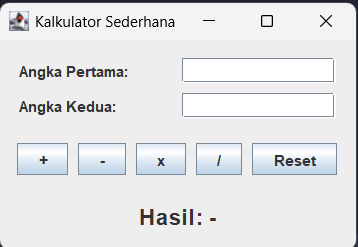
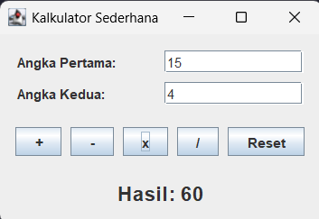
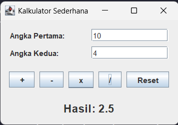
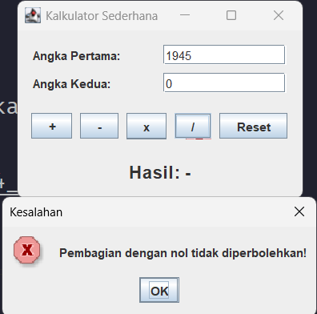
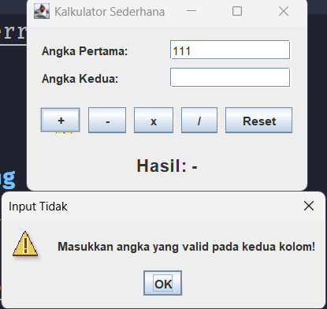
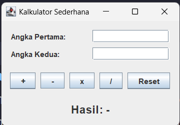

# 🧮 Kalkulator Sederhana (Java Swing GUI)

Aplikasi kalkulator desktop sederhana berbasis antarmuka grafis (GUI) yang dibangun menggunakan bahasa pemrograman **Java** dan pustaka **Java Swing / AWT**. Proyek ini dibuat sebagai implementasi konsep **Pemrograman Berorientasi Objek (PBO)** dan penanganan event (*event handling*) pada komponen antarmuka desktop.

---

## 📌 Fitur Utama

- **Operasi Aritmatika Dasar**:
  - Penjumlahan (`+`)
  - Pengurangan (`-`)
  - Perkalian (`x`)
  - Pembagian (`/`)
- **Pembersihan Data (*Reset*)**: Mengosongkan form input, mengembalikan label hasil, dan otomatis memfokuskan kursor kembali ke kolom pertama.
- **Dukungan Format Desimal Fleksibel**: Menerima input desimal baik menggunakan tanda titik (`.`) maupun koma (`,`).
- **Formatting Hasil Pintar**: Menampilkan angka bulat tanpa desimal nol di belakang (contoh: `10` bukan `10.0`), namun tetap mempertahankan desimal jika hasilnya pecahan.
- **Validasi Input & Error Handling**:
  - Pesan peringatan (*Warning Dialog*) jika kolom input kosong atau berisi karakter non-angka.
  - Pesan kesalahan (*Error Dialog*) jika terjadi pembagian dengan angka nol (`0`).

---

## 🏗️ Komponen & Tata Letak (Layout)

Proyek ini menerapkan *hierarchical layout* dengan membagi antarmuka menjadi beberapa panel:
- **`BorderLayout` (Frame Utama)**:
  - **`BorderLayout.NORTH`**: Menampung `panelInput` yang berisi label dan kolom input angka.
  - **`BorderLayout.CENTER`**: Menampung `panelTombol` yang berisi deretan tombol operasi dan tombol reset.
  - **`BorderLayout.SOUTH`**: Menampung `lblHasil` untuk menampilkan status atau hasil perhitungan.
- **`GridLayout(2, 2)`**: Digunakan pada `panelInput` untuk menyusun label dan `JTextField` secara rapi dan simetris.
- **`FlowLayout`**: Digunakan pada `panelTombol` untuk meratakan tombol secara horizontal di tengah (*center aligned*).
- **`JOptionPane`**: Digunakan untuk menampilkan dialog pesan pop-up validasi.

---

## 📁 Struktur Berkas

```text
pbo_gui/
├── KalkulatorSederhana.java   # Source code utama aplikasi
├── README.md                  # Dokumentasi proyek
└── screenshots/               # Folder tangkapan layar antarmuka aplikasi
    ├── 01_tampilan_awal.png
    ├── 02_operasi_hitung.png
    ├── 03_operasi_desimal.png
    ├── 04_error_bagi_nol.png
    ├── 05_error_input_kosong.png
    └── 06_setelah_reset.png
```

---

## ⚙️ Persyaratan Sistem

- **Java Development Kit (JDK)**: Versi 8 atau yang lebih baru (JDK 11, 17, atau 21 direkomendasikan).
- **Sistem Operasi**: Windows, macOS, atau Linux.

---

## 🚀 Cara Menjalankan Program

### Melalui Terminal / Command Prompt / PowerShell

1. Buka terminal dan arahkan ke direktori proyek:
   ```bash
   cd d:/DEVELOPMENT/java/pbo_gui
   ```

2. Kompilasi file Java:
   ```bash
   javac KalkulatorSederhana.java
   ```

3. Jalankan aplikasi:
   ```bash
   java KalkulatorSederhana
   ```

### Melalui IDE (VS Code, IntelliJ IDEA, NetBeans, atau Eclipse)
1. Buka folder proyek di IDE pilihan Anda.
2. Buka file `KalkulatorSederhana.java`.
3. Tekan tombol **Run** atau klik kanan lalu pilih **Run 'KalkulatorSederhana.main()'**.

---

## 📷 Daftar Tangkapan Layar (Screenshots)

Berikut adalah panduan tangkapan layar yang disarankan untuk melengkapi dokumentasi laporan/repositori:

### 1. Tampilan Awal Program
Tampilan form kalkulator saat pertama kali dijalankan dalam keadaan bersih/kosong.


---

### 2. Operasi Perhitungan Bilangan Bulat
Contoh eksekusi salah satu operasi dasar (misalnya perkalian `15 x 4 = 60`).


---

### 3. Operasi Bilangan Desimal
Contoh operasi dengan hasil atau input berupa bilangan berkoma/pecahan (misalnya `7.5 + 2.5` atau `10 / 4 = 2.5`).


---

### 4. Validasi Pembagian dengan Nol
Dialog pop-up error yang muncul ketika angka kedua bernilai `0` pada operasi pembagian.


---

### 5. Validasi Input Tidak Valid / Kosong
Dialog pop-up peringatan yang muncul jika salah satu kolom kosong atau diisi huruf/simbol non-angka.


---

### 6. Tampilan Setelah Tombol Reset Ditekan
Kondisi saat tombol **Reset** ditekan, di mana form kembali kosong, hasil kembali ke `Hasil: -`, dan kursor aktif kembali di kolom pertama.



---

## 👨‍💻 Penulis

- **Pengembang**: [Maulidar Ihlas]
- **Mata Kuliah**: Pemrograman Berorientasi Objek (PBO)
- **Teknologi**: Java Swing & AWT
